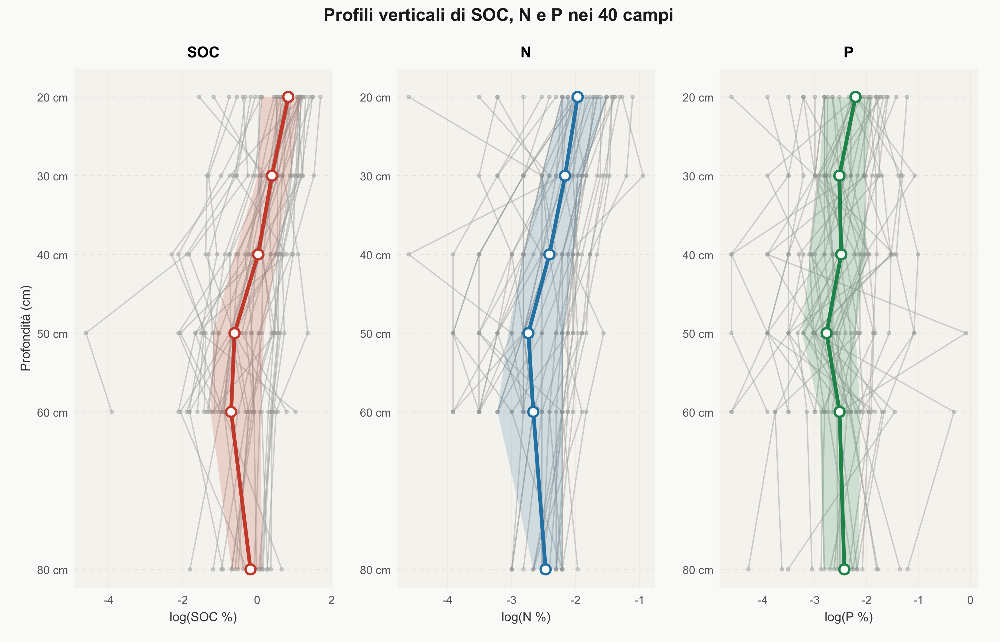

# Analisi gerarchica bayesiana dei profili verticali di nutrienti del suolo
# *Bayesian Hierarchical Analysis of Soil Nutrient Vertical Profiles*

**[Italiano](#italiano) · [English](#english)** · [Report (PDF)](report.pdf) · [Web](https://gabripaganelli.github.io/projects/crop-soil-analysis.html)


*Profili verticali (scala log) di carbonio organico, azoto e fosforo nei 40 campi: linee grigie i singoli campi, linea colorata la mediana per profondità, banda l'intervallo interquartile · Vertical profiles (log scale) of organic carbon, nitrogen and phosphorus in the 40 fields: grey lines are individual fields, the coloured line is the median by depth, the band is the interquartile range — report, Fig. 3*

---

## Italiano

### Panoramica

Progetto universitario di analisi della distribuzione verticale dei nutrienti del suolo —
carbonio organico (SOC), azoto totale (N) e fosforo totale (P) — in 40 campi agricoli
in Tanzania, nell'ambito del corso di Statistica Iterazione
(Università degli Studi di Padova, a.a. 2025/26).

### Metodologia

L'analisi impiega un modello bayesiano gerarchico con pendenza proporzionale ed effetti
casuali multivariati, stimato tramite Stan (MCMC). Il modello stima esplicitamente come
la variabilità inter-campo del profilo verticale cambi con la profondità, con struttura
di covarianza LKJ che cattura le correlazioni cross-risposta a livello di campo.

I risultati mostrano che i campi con maggiore contenuto medio di carbonio organico
presentano profili significativamente più uniformi: la fertilità carboniosa si conserva
meglio in profondità. Per l'azoto questo pattern è assente; per il fosforo è presente
con evidenza moderata.

La selezione predittiva (*projpred*) identifica la tessitura fine (contrasto
frazioni fini/sabbia, ILR) come principale predittore *within-field*. Le pratiche
di gestione risultano non significative dopo aver controllato per la struttura fisica
del suolo.

### Struttura del repository

```
crop-soil-analysis/
├── README.md
├── LICENSE
├── CITATION.cff
├── report.pdf                  # Report pre-compilato (visualizzazione diretta)
├── figures/                    # Immagine del README
├── data/
│   ├── crop.csv                # Dati grezzi (fonte canonica)
│   ├── crop_full.rds           # Cache: dataset completo (rigenerato da 01_preprocessing.R)
│   └── crop_analytic.rds       # Cache: subset analitico (ILR, log-risposte, scaling)
├── stan/                       # Modelli Stan — vedi stan/README.md
│   └── model_mvre.stan         # Modello finale
├── scripts/                    # Pipeline R — vedi scripts/README.md
│   ├── 00_utilities.R          # Funzioni condivise
│   ├── 01_preprocessing.R
│   ├── 02_eda_texture.R
│   └── run_all.R               # Master script (esegue 07–22)
├── output/
│   ├── figures/                # Tutte le figure (EDA + modello + mappe)
│   └── tables/                 # Tabelle CSV con risultati
└── docs/
    ├── crop.pdf                # Documentazione dati originali
    ├── map1.jpg                # Mappa area di studio (screenshot Google Earth)
    └── map2.jpg                # Mappa area di studio (screenshot Google Earth)
```

### Installazione

R ≥ 4.3 e CmdStan ≥ 2.33.

```r
install.packages(c(
  "tidyverse", "here", "cmdstanr", "posterior", "loo", "projpred",
  "compositions", "soiltexture", "patchwork", "lme4", "lmerTest",
  "nlme", "spdep", "ggbeeswarm", "MCMCglmm", "sommer"
))

# Installazione CmdStan
cmdstanr::install_cmdstan()
```

> **Windows**: è necessario [Rtools](https://cran.r-project.org/bin/windows/Rtools/)
> per compilare i modelli Stan.

### Utilizzo

```r
library(here)

# 1. Pre-elaborazione dati (una volta sola — produce data/crop_full.rds e data/crop_analytic.rds)
source(here("scripts", "01_preprocessing.R"))

# 2. EDA esplorativa (opzionale, da eseguire manualmente — script 02–06, incl. 04b/05b)
source(here("scripts", "02_eda_texture.R"))
#   ...03_eda_functional_form.R, 04_eda_depth_profiles.R, 04b_eda_profiles_summary.R,
#      05_eda_spatial.R, 05b_eda_spatial_maps.R, 06_lmm_exploratory.R

# 3. Pipeline modelli + figure (script 07–22)
source(here("scripts", "run_all.R"))
```

> **Nota**: I fit Stan (file `.rds`, ~100–700 MB ciascuno) non sono inclusi nel
> repository (`.gitignore`). La prima esecuzione compila e campiona tutti i modelli
> — può richiedere diverse ore. I fit vengono salvati in `stan/` e riutilizzati
> nelle esecuzioni successive.

> **Dati e output pre-generati**: `data/crop_full.rds` e `data/crop_analytic.rds` sono
> cache derivate, rigenerate da `01_preprocessing.R` a partire da `data/crop.csv` (fonte
> canonica). Figure (`output/figures/`), tabelle (`output/tables/`) e `report.pdf` sono
> versionati: possono essere consultati senza eseguire l'intera pipeline.

> **Riproducibilità**: tutti i campionamenti MCMC usano `seed = 2024`. Per le versioni
> esatte dei pacchetti eseguire `sessionInfo()`. Su Windows il percorso di Rtools può
> essere impostato con la variabile d'ambiente `RTOOLS45_HOME`.

### Risultati

**Risultati principali** (dal report, Tab. 3–4 e §5.4, §6.3):
- I campi con più carbonio organico medio hanno profili più uniformi in profondità: la correlazione tra intercetta e pendenza casuale del carbonio è ρ_SOC = +0,52 (CI 90% [0,12; 0,80]); per l'azoto è compatibile con zero, per il fosforo l'incertezza è troppo elevata per trarre conclusioni
- La tessitura fine (contrasto frazioni fini/sabbia, ILR) è il principale predittore *within-field* per carbonio e azoto (coefficienti −0,50 e −0,28); per il fosforo nessuna covariata fisica è informativa
- Le pratiche di gestione non vengono selezionate da *projpred* per nessuna risposta, e le loro stime non sono interpretabili come effetti causali per il confondimento strutturale tra le variabili di gestione e geografico con la posizione dei campi

Il report pre-compilato è disponibile in [`report.pdf`](report.pdf) per la visualizzazione diretta.

Il report include:
- Analisi esplorativa della tessitura e dei profili di profondità
- Selezione e confronto dei modelli tramite LOO-CV
- Stime e diagnostiche del modello finale
- Selezione predittiva delle variabili con *projpred*
- Interpretazione agronomica delle correlazioni cross-risposta

### Autori

**Bortoletto Davide, Faedo Piero, Paganelli Gabriele, Zannini Pietro** — Statistica Iterazione, Università degli Studi di Padova, a.a. 2025/26.

### Fonte dei dati

`data/crop.csv` — documentazione in [`docs/crop.pdf`](docs/crop.pdf).

Il MIT copre solo il codice: i dati e `docs/crop.pdf` sono materiale del corso; le mappe in `docs/` sono screenshot di Google Earth (immagini © Maxar Technologies, Landsat/Copernicus, CNES/Airbus).

---

## English

### Overview

University project analysing the vertical distribution of soil nutrients —
organic carbon (SOC), total nitrogen (N), and total phosphorus (P) — across
40 agricultural fields in Tanzania, developed for the Statistics: Case Studies
course (University of Padova, academic year 2025/26).

### Methodology

The analysis employs a Bayesian hierarchical model with proportional slope and
multivariate random effects, estimated via Stan (MCMC). The model explicitly
estimates how inter-field variability in the vertical profile changes with depth,
using an LKJ covariance structure to capture cross-response correlations at the
field level.

Results show that fields with higher mean organic carbon content exhibit
significantly flatter profiles: carbon fertility is better preserved at depth.
This pattern is absent for nitrogen and present with moderate evidence for
phosphorus.

Predictive variable selection (*projpred*) identifies fine texture (fine
fraction/sand contrast, ILR) as the main *within-field* predictor. Management
practices are not significant after controlling for soil physical structure.

### Repository Structure

```
crop-soil-analysis/
├── README.md
├── LICENSE
├── CITATION.cff
├── report.pdf                  # Pre-compiled report (for direct viewing)
├── figures/                    # README image
├── data/
│   ├── crop.csv                # Raw data (canonical source)
│   ├── crop_full.rds           # Cache: full dataset (regenerated by 01_preprocessing.R)
│   └── crop_analytic.rds       # Cache: analytic subset (ILR, log-responses, scaling)
├── stan/                       # Stan models — see stan/README.md
│   └── model_mvre.stan         # Final model
├── scripts/                    # R pipeline — see scripts/README.md
│   ├── 00_utilities.R          # Shared functions
│   ├── 01_preprocessing.R
│   ├── 02_eda_texture.R
│   └── run_all.R               # Master script (runs 07–22)
├── output/
│   ├── figures/                # All figures (EDA + model + maps)
│   └── tables/                 # CSV tables with results
└── docs/
    ├── crop.pdf                # Original data documentation
    ├── map1.jpg                # Study-area map (Google Earth screenshot)
    └── map2.jpg                # Study-area map (Google Earth screenshot)
```

### Installation

R ≥ 4.3 and CmdStan ≥ 2.33.

```r
install.packages(c(
  "tidyverse", "here", "cmdstanr", "posterior", "loo", "projpred",
  "compositions", "soiltexture", "patchwork", "lme4", "lmerTest",
  "nlme", "spdep", "ggbeeswarm", "MCMCglmm", "sommer"
))

# Install CmdStan
cmdstanr::install_cmdstan()
```

> **Windows**: [Rtools](https://cran.r-project.org/bin/windows/Rtools/) is required
> to compile Stan models.

### Usage

```r
library(here)

# 1. Data pre-processing (once only — produces data/crop_full.rds and data/crop_analytic.rds)
source(here("scripts", "01_preprocessing.R"))

# 2. Exploratory EDA (optional, run manually — scripts 02–06, incl. 04b/05b)
source(here("scripts", "02_eda_texture.R"))
#   ...03_eda_functional_form.R, 04_eda_depth_profiles.R, 04b_eda_profiles_summary.R,
#      05_eda_spatial.R, 05b_eda_spatial_maps.R, 06_lmm_exploratory.R

# 3. Model + figure pipeline (scripts 07–22)
source(here("scripts", "run_all.R"))
```

> **Note**: Stan fit files (`.rds`, ~100–700 MB each) are not included in the
> repository (`.gitignore`). The first run compiles and samples all models —
> this may take several hours. Fits are saved to `stan/` and reused on subsequent
> runs.

> **Pre-generated data and outputs**: `data/crop_full.rds` and `data/crop_analytic.rds`
> are cached derivatives, regenerated by `01_preprocessing.R` from `data/crop.csv` (the
> canonical source). Figures (`output/figures/`), tables (`output/tables/`) and
> `report.pdf` are version-controlled — they can be inspected without running the full
> pipeline.

> **Reproducibility**: all MCMC sampling uses `seed = 2024`. For exact package versions
> run `sessionInfo()`. On Windows the Rtools path can be set via the `RTOOLS45_HOME`
> environment variable.

### Results

**Key findings** (from the report, Tables 3–4 and §5.4, §6.3):
- Fields with higher mean organic carbon have more uniform depth profiles: the correlation between the random intercept and slope for carbon is ρ_SOC = +0.52 (90% CI [0.12, 0.80]); for nitrogen it is compatible with zero, for phosphorus the uncertainty is too large to draw conclusions
- Fine texture (fine fraction/sand contrast, ILR) is the main *within-field* predictor for carbon and nitrogen (coefficients −0.50 and −0.28); no physical covariate is informative for phosphorus
- Management practices are not selected by *projpred* for any response, and their estimates cannot be read as causal effects because of structural confounding among the management variables and geographic confounding with field location

A pre-compiled report is available at [`report.pdf`](report.pdf) for direct viewing.

The report includes:
- Exploratory analysis of texture and depth profiles
- Model selection and comparison via LOO-CV
- Estimates and diagnostics for the final model
- Predictive variable selection with *projpred*
- Agronomic interpretation of cross-response correlations

### Authors

**Bortoletto Davide, Faedo Piero, Paganelli Gabriele, Zannini Pietro** — Statistics: Case Studies, University of Padova, academic year 2025/26.

### Data source

`data/crop.csv` — documentation in [`docs/crop.pdf`](docs/crop.pdf).

The MIT license covers the code only: the data and `docs/crop.pdf` are course material; the maps in `docs/` are Google Earth screenshots (imagery © Maxar Technologies, Landsat/Copernicus, CNES/Airbus).